# Personal Expenses Tracker

## Abstract

The Personal Expenses Tracker is a Flutter-based mobile application developed to help users keep track of their daily expenses in a simple and organized way. The application will provide features such as adding expenses, viewing expense details, managing expense categories, and checking total spending.

The project is developed step by step by implementing different Flutter and Dart concepts through experiments. The application will gradually be improved by adding widgets, layouts, responsive design, user input, expense lists, and other useful features.

## Expected App

The final application is expected to provide a simple and user-friendly interface for managing personal expenses. Users will be able to view their total spending, add new expenses, view expense details and organize expenses based on categories.

### Expected Final Output

The final output is expected to contain a dashboard showing the total expenses, a list of recent expenses with their categories and amounts, and an option to add a new expense.

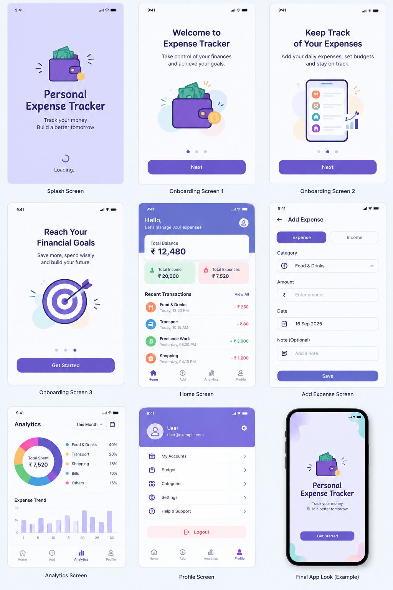

## Experiment 1(A) – Introduction to Flutter

In this experiment, I created the basic Personal Expenses Tracker project and worked with some basic Dart concepts. A simple program was created using variables and print statements to display basic expense-related information in the terminal.

The program displays the application name, expense category, and expense amount. This experiment helped in understanding the basic structure of a Dart program before moving on to Flutter widgets and user interface development.

## Experiment 1(A) Output

The following screenshot shows the terminal output of the basic Personal Expenses Tracker program.
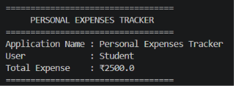

## Experiment 1(B) – Basic Flutter Application

In this experiment, a basic Flutter application is created using widgets such as `MaterialApp`, `Scaffold`, `AppBar`, `Column`, `Text`, and `Container`. A simple Personal Expenses Tracker screen is designed to display the application title, expense heading and total expense. This experiment helps in understanding the basic structure of a Flutter user interface and how different widgets are arranged together.

## Experiment 1(B) Output

The following screenshot shows the basic Personal Expenses Tracker interface created using Flutter widgets.

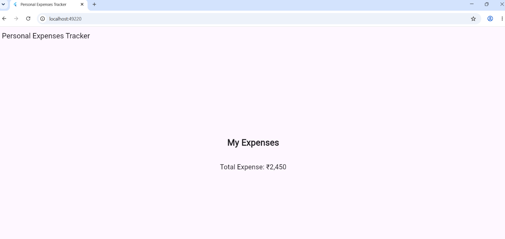

## Experiment 2(A) – Flutter Widgets and Layouts

In this experiment, the Personal Expenses Tracker interface is improved using different Flutter widgets and layouts. Widgets such as `Card`, `Row`, `Column`, `Expanded`, `Padding`, and `ListTile` are used to arrange the expense information. The screen displays the total expense, monthly expense and a list of recent expenses. This experiment helps in understanding how Flutter widgets can be combined to create a simple and organized user interface.

## Experiment 2(A) Output

The following screenshot shows the Expense Dashboard created using Flutter widgets and layouts.

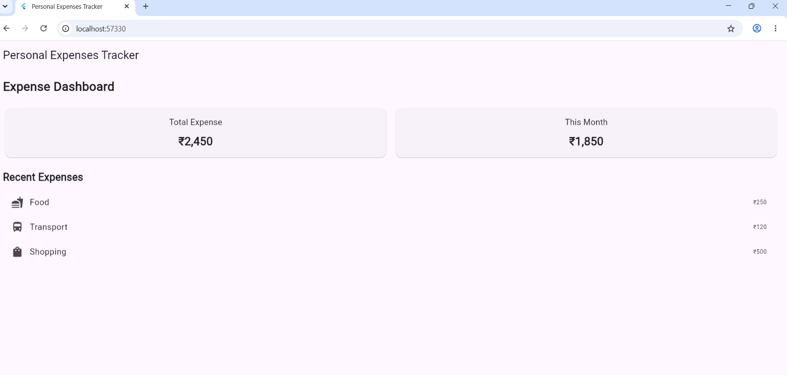

## Experiment 2(B) – Buttons and Basic Interaction

In this experiment, basic interaction is added to the Personal Expenses Tracker application. An Add Expense button is created using the ElevatedButton widget. A StatefulWidget and setState() are used to update the total expense when the button is pressed. This makes the application interactive and prepares it for adding more expense management features in the upcoming experiments.

## Experiment 2(B) Output

The following screenshot shows the Personal Expenses Tracker application with the Add Expense button and updated expense interaction.

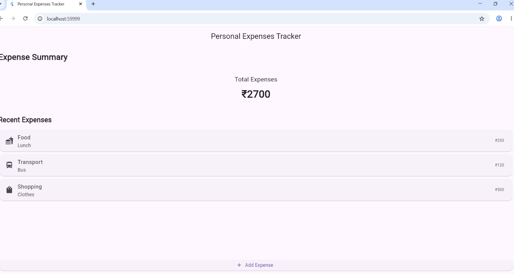

## Experiment 3(A) – Text Fields and User Input

In this experiment, text fields are added to the Personal Expenses Tracker application to allow the user to enter expense details. TextField widgets and TextEditingController are used to collect the expense name and amount from the user. When the Add Expense button is pressed, the entered expense is added to the expense list and the total expense is updated using setState(). This experiment helps in understanding user input and handling data in a Flutter application.

## Experiment 3(A) Output

The following screenshot shows the Personal Expenses Tracker application with text fields for entering an expense name and amount, along with the updated expense list.

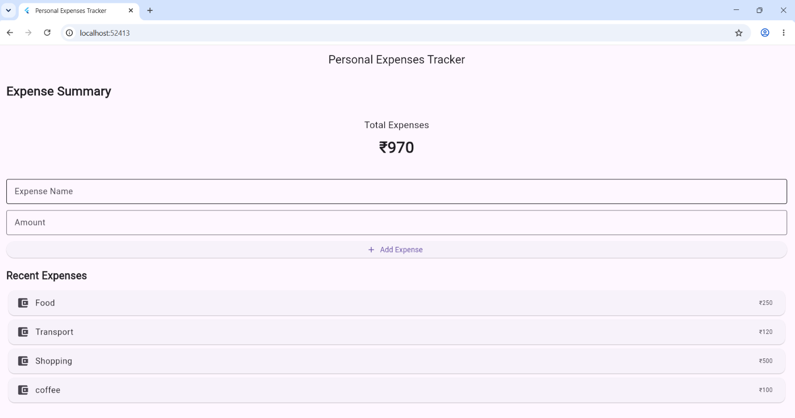

## Experiment 3(B) – Category and Date Selection

In this experiment, category and date selection features are added to the Personal Expenses Tracker application. A dropdown menu is used to select the expense category, and a date picker is used to select the expense date. The selected category and date are stored along with the expense details.

## Experiment 3(B) Output

The following screenshot shows the Personal Expenses Tracker application with category selection, date selection and expense details.

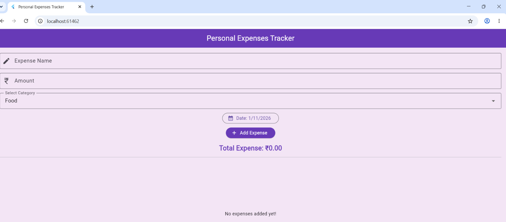

## Experiment 4(A) – Delete Expense and List Management

In this experiment, a delete option is added to the Personal Expenses Tracker application. An IconButton with a delete icon is used to remove expenses from the list. The setState() method is used to update the application whenever an expense is deleted. The total expense is automatically recalculated after deleting an item. This experiment helps in understanding list management and state updates in Flutter.

## Experiment 4(A) Output

The following screenshot shows the Personal Expenses Tracker application with the expense list and delete option.

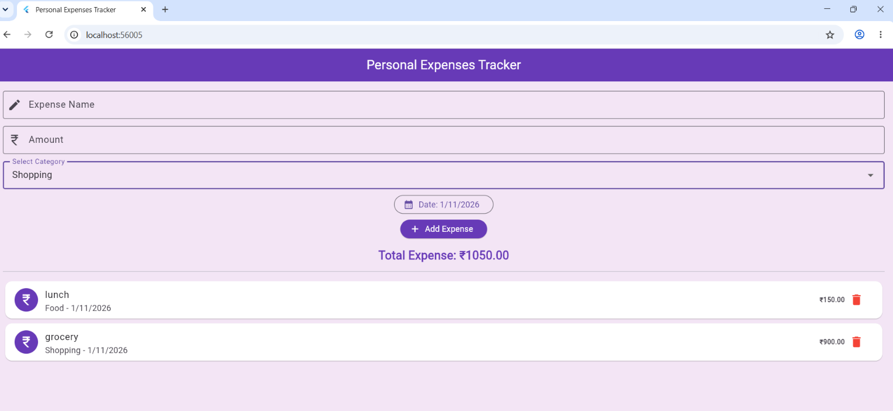

## Experiment 4(B) – Edit Expense Details

In this experiment, an edit option is added to the Personal Expenses Tracker application. An edit icon is provided for each expense. The user can update the expense name, amount, category and date using an AlertDialog. The setState() method is used to update the expense details and automatically recalculate the total amount. This experiment helps in understanding dialog boxes and updating list data in Flutter.

## Experiment 4(B) Output

The following screenshot shows the Personal Expenses Tracker application with the edit expense feature.

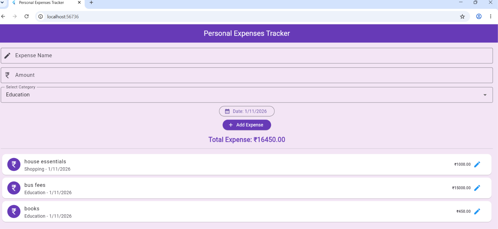

## Experiment 5(A) – Local Data Storage

### Description
In this experiment, local data storage is implemented in the Personal Expenses Tracker using the `shared_preferences` package.

The application saves expense details such as expense name, amount, category, and date. The saved data is loaded automatically when the application is opened again.

### Features
- Save expense details locally.
- Automatically load saved expenses.
- Data remains available after refreshing the application.
- Edit and delete saved expenses.
- Automatically update the total expense amount.

### Expected App Image
The application displays the expense entry form, category selection, date picker, total expense, and saved expense list.

### Experiment 5(A) Output

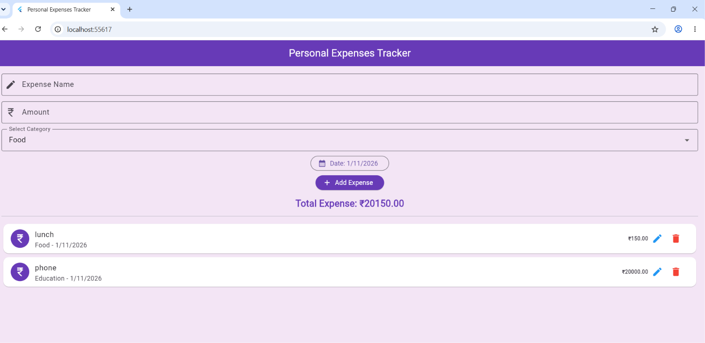

## Experiment 5(B) – Expense Summary and Category-wise Analysis

### Description
In this experiment, a dashboard is developed for the Personal Expenses Tracker to display total expenses and category-wise spending details.

The application calculates the amount spent in each category and displays the results using colourful progress bars.

### Features
- Display total expenses.
- Show the number of recorded expenses.
- Calculate category-wise expenses.
- Display spending percentages using progress bars.
- View recent expense details.
- Add, edit, and delete expenses.
- Automatically update the summary when expenses change.
- Maintain expense records using SharedPreferences.

### Expected App Image
The dashboard displays the total expense amount, category-wise summary, colourful progress bars, and recent expenses.

### Experiment 5(B) Output

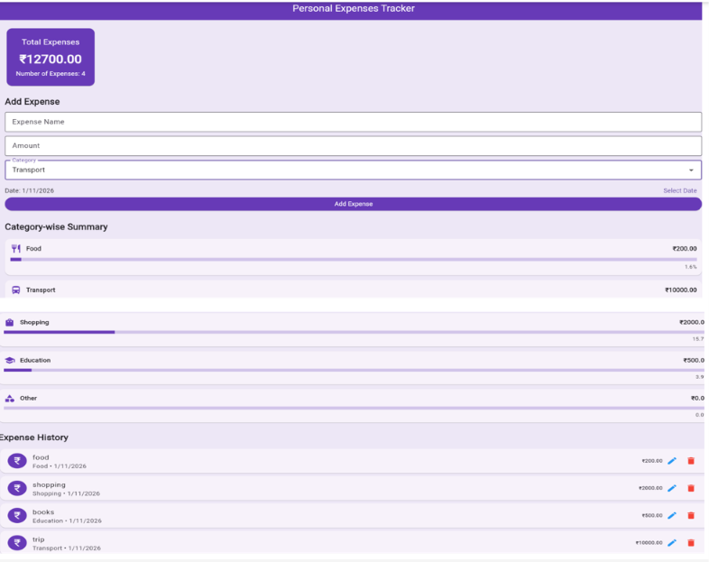

## Experiment 6(A): Expense Filtering by Category

### Description
In this experiment, category filtering was added to the Personal Expenses Tracker. Users can filter their expenses based on different categories.

### Features
- Added category filters: All, Food, Transport, Shopping, Education and Other.
- Displays only expenses belonging to the selected category.
- Added category-wise expense summary.
- Maintains add, edit and delete expense features.
- Saves expense details using SharedPreferences.

### Expected App Image
The application displays category filter chips and the expenses based on the selected category.

### Experiment 6(A) Output
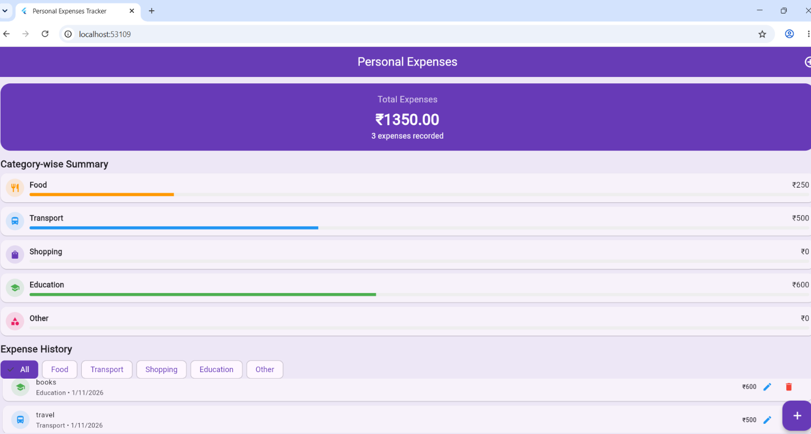

## Experiment 6(B): Search Expenses by Name

### Description
In this experiment, a search feature was added to the Personal Expenses Tracker to help users find expenses by entering their names.

### Features
- Added a search bar to search expenses by name.
- Displays matching expenses based on the entered text.
- Added a clear button to reset the search.
- Search works together with category filtering.
- Existing add, edit, delete and local storage features are maintained.

### Expected App Image
The application displays a search bar above the expense history.

### Experiment 6(B) Output
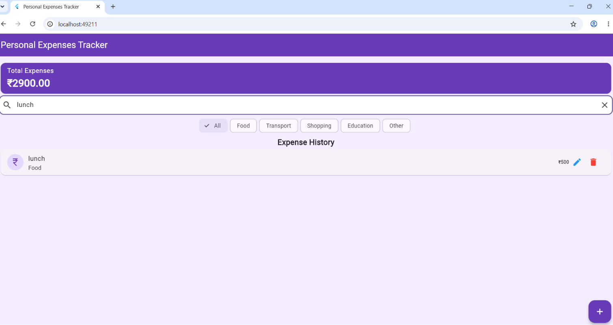

## Experiment 7: Expense Data Visualization using Charts

### Description
In this experiment, charts were added to the Personal Expenses Tracker to display spending information visually.

### Features
- Added a pie chart for category-wise expense distribution.
- Added a bar chart to compare spending across categories.
- Charts update automatically when expenses are added, edited or deleted.
- Maintained search and category filtering.
- Continued using SharedPreferences for local data storage.

### Expected App Image
The application displays pie and bar charts showing the user's expense distribution and category-wise spending.

### Experiment 7 Output
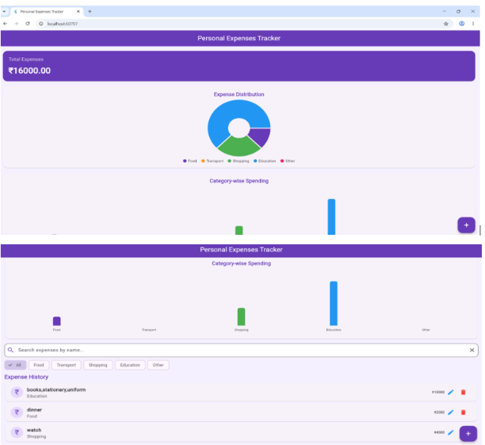

